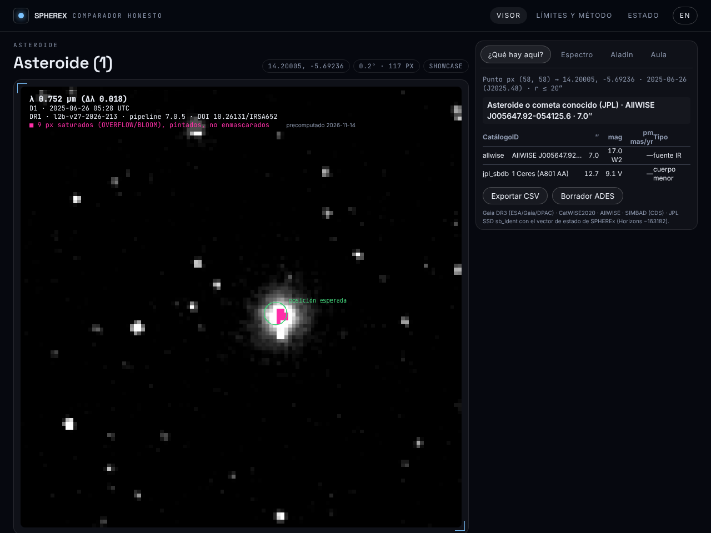

# El comparador honesto de SPHEREx · *The honest SPHEREx comparator*

**NASA Space Apps Challenge 2026 · reto "Planet X and SPHEREx" (Advanced) · construido el 14–15 de noviembre de 2026**

> SPHEREx fotografía todo el cielo en 102 colores infrarrojos, pero cada píxel ve un color distinto: un simple
> "antes y después" miente. Este visor es el comparador honesto: cada cuadro muestra su λ real, cada visita se
> colapsa en un coadd ponderado por su varianza, cada resta pasa un veredicto espectral, cada punto se mide en
> µJy con su error y se cruza con Gaia DR3, CatWISE2020, AllWISE, SIMBAD y los asteroides conocidos.
> **Lo que no se puede ver, lo decimos con números.** No prometemos encontrar el Planeta X.

- Demo pública: **ver `docs/DEPLOY.md`** (Vercel, sitio estático; el proyecto se crea desde la cuenta del equipo).
- Textos de la plataforma: `docs/SUBMISSION.md`. Guion del video y slides: `docs/DEMO.md`. Decisiones con hora UTC: `docs/DECISIONES.md`.
- Video de 30 s para la plataforma: `docs/demo/demo.mp4` (subtítulos EN); GIF: `docs/demo/demo.gif`; capturas en `docs/demo/shot_*.png`.



## Qué hace

| Pieza | Qué muestra | Dónde |
|---|---|---|
| **Línea de tiempo por visita** | Exposiciones separadas < 1 día → un coadd 1/VARIANCE con ZODI restado. Dentro de la visita, la **escalera de λ** (una exposición = un ancho de banda) | `/view` |
| **λ impresa en cada cuadro** | λ (exacta o min–max–media), detector, fecha UTC, release (QR2/QR3/DR1 + DOI), versión l2b, versión de pipeline | etiqueta del cuadro |
| **Veredicto espectral** | `ok` ≤ 2 canales · `warn` 3–8 · `block` > 8, con el residuo esperado (4 % + 1.4 %/canal, medido) | modo A − B |
| **Saturación pintada** | OVERFLOW (bit 1) y BLOOM (bit 26) en magenta, contados en la apertura, nunca enmascarados | cuadro + etiqueta |
| **Referencia de 2010** | AllWISE W2 (IRSA) reproyectado a la misma malla: 15 años de movimiento propio píxel a píxel | primer cuadro de la secuencia |
| **¿Qué hay aquí?** | Gaia DR3 (propagado a la fecha), CatWISE2020, AllWISE, SIMBAD, JPL `sb_ident` con el vector de estado de SPHEREx → `known_star / known_ir_source / known_sso / candidate`; export CSV y borrador ADES | panel lateral |
| **Espectro y curva de luz** | Fotometría de apertura por exposición y por visita en µJy con barras de error (uPlot) | panel lateral |
| **Limits & Method** | Residuo por Δλ, pm medido vs Gaia, inyección-recuperación en coadds reales, lo que no se ve, Field Guide de artefactos reales | `/limits` |
| **Aula** | Explicación por objeto en ES/EN | panel lateral |
| **Qué mirar primero** | Cambios detectados solo entre exposiciones del mismo canal (|Δ| = 0, veredicto ok por construcción), S/N ≥ 6, cruzados con los catálogos; cada uno marca si se repite o si es una sola exposición (posible artefacto) | panel lateral |
| **Misma λ** | Un clic elige como B la exposición de otra visita con el canal más cercano al de A | modo A − B |
| **Traza** | Máximo píxel a píxel de visitas y escalera actual: Ceres aparece en sus dos posiciones | modo |
| **Curva de luz a λ fija** | Exposiciones del mismo canal (±1) a lo largo del tiempo: la curva honesta frente a la «por visita» | panel espectro |
| **Control con estrellas de campo** | El mismo ajuste de pm aplicado a estrellas Gaia del campo: su |pm| residual es el piso sistemático | `/limits` |
| **Completitud por velocidad** | Movers sintéticos recuperados a ciegas en los coadds reales de WISE 0855 D5 | `/limits` |

Objetos del showcase (precomputados, < 2 s): WISE 0855−0714, ε Indi Ba/Bb, estrella de Barnard, RW Aur, R Dra,
asteroides (1) Ceres, (2) Palas y (7) Iris en cuadratura, dos posiciones del campo profundo del polo norte eclíptico,
una variable roja no saturada del campo profundo (Gaia DR3 2257667121267351296, 48 de sus ~150 visitas) y un campo aleatorio.

## Resultados que respaldan la tesis (datos reales, 14 nov 2026)

- WISE 0855 en D5: 6 visitas, 430–510 µJy por coadd (W2 = 13.9 ⇒ ≈ 430 µJy), movimiento 1.2–1.7 ± 0.3 px/año vs 1.33 esperado;
  estrellas de campo de control: 0.03–0.11 px/año.
- ε Indi Ba/Bb en D2: 14 visitas sin saturación, 0.72 ± 0.04 px/año vs 0.76; su espectro muestra la banda de agua a 1.39 µm.
- Residuo de la resta (PoC 9 nov): fondo 0.80–0.87 del ruido; estrellas 4 % + 1.4 %/canal; 25 % a 16 canales.
- Completitud 50 % por inyección: AB 17.7 (WISE 0855 D5, n = 8), 18.5 (ε Indi B D2 y Barnard D3). Por velocidad (a ciegas):
  70–80 % hasta 3 px/año a 1 200 µJy; cae a 4 px/año al salir de la caja de búsqueda.
- Variable roja del campo profundo: 362 visitas, 45–55 mJy sin saturar, curva de luz a λ fija.
- Paralaje: 0.07–0.09 px, no medible. Planeta Nueve: 3–5 mag por debajo del límite de una visita.

## Estructura

```
apps/web        Next.js 15 + TypeScript (App Router, Tailwind 4, nuqs, next-intl, aladin-lite 3.8.2, uPlot, fast-png). Export estático.
apps/api        Python 3.12 + FastAPI, Clean Architecture: domain/ (modelos, flags, veredicto, fotometría) · usecases/ (build_visits,
                reproyección, serialización, diff, known) · adapters/ (irsa_tap, s3_range, spherex_fits, allwise_ref, simbad, jpl,
                frame_store, png16) · api/ (rutas + esquemas Pydantic). modal_app.py para el modo en vivo.
packages/shared Tipos TS generados del OpenAPI (openapi-typescript) y constantes.
scripts/        precompute.py (showcase) · find_asteroid_fields.py · find_changes.py (cambios a λ igual) · limits_analysis.py · og_image.py · record_demo.py
docs/           DECISIONES.md · SUBMISSION.md · DEMO.md · DEPLOY.md · investigación previa 01–15 (8–9 nov)
poc/            PoC de acceso a datos previa al evento (ver "Hackathon Journey")
```

## Cómo correrlo

```bash
# Backend (Python ≥ 3.12)
uv venv .venv && . .venv/bin/activate && uv pip install -e "apps/api[dev]"
cd apps/api && uvicorn app.main:app --reload --port 8000      # http://localhost:8000/docs
```

```bash
# Web (Node 22, pnpm 9)
pnpm install && pnpm dev                                      # http://localhost:3000/es/
# o export estático:
pnpm build && python -m http.server 3000 --directory apps/web/out
```

```bash
# Showcase y Limits (requieren red hacia IRSA/S3/JPL; cache en apps/api/.cache)
SPHEREX_CACHE_DIR=apps/api/.cache python scripts/precompute.py
SPHEREX_CACHE_DIR=apps/api/.cache python scripts/limits_analysis.py
```

```bash
# Tests
pnpm test && pnpm typecheck && pnpm lint
cd apps/api && pytest -q                 # SPHEREX_OFFLINE=1 salta los tests de red
```

Modo en vivo (cualquier RA/Dec): `cd apps/api && modal deploy modal_app.py` y poner la URL en `NEXT_PUBLIC_API_URL`.
Sin API, el front muestra "modo en vivo no disponible" y sirve solo el showcase.

## Contrato de API (v2)

`GET /api/visits?name|ra,dec,epoch,pmra,pmdec&fov&det&release` · `GET /api/diff?a&b` · `GET /api/spectrum` ·
`GET /api/lightcurve` · `GET /api/known?ra&dec&r_arcsec&mjd` · `GET /api/health`. OpenAPI en `apps/api/openapi.json`.

## Datos y atribución

- **SPHEREx Quick Release 2**, NASA/IPAC Infrared Science Archive, DOI [10.26131/IRSA652](https://doi.org/10.26131/IRSA652).
- **SPHEREx Quick Release 3**, DOI [10.26131/IRSA662](https://doi.org/10.26131/IRSA662).
- **SPHEREx Data Release 1** (nov 2026, reprocesamiento de QR2; se cita con el DOI de QR2 mientras IRSA no publique uno propio).
- "This publication makes use of data products from the SPHEREx mission, funded by NASA and operated by JPL/Caltech;
  data are hosted by the NASA/IPAC Infrared Science Archive."
- Acceso: IRSA TAP (`spherex.plane`, `spherex.artifact`, `gaia_dr3_source`, `catwise_2020`, `allwise_p3as_psd`), bucket
  público `s3://nasa-irsa-spherex` (AWS Open Data) por HTTP Range, cutout service de IRSA, atlas AllWISE por IBE.
- Gaia DR3 (ESA/Gaia/DPAC); CatWISE2020 (Marocco et al. 2021); AllWISE (Cutri et al. 2013); SIMBAD y Aladin Lite (CDS,
  Estrasburgo; Aladin Lite LGPL-3.0); JPL Solar System Dynamics (Horizons, sb_ident).
- Software: astropy, reproject, photutils, scipy, numpy, pyvo, FastAPI, Next.js, uPlot, fast-png, Pillow, Playwright, Modal.
- Narración del modo aula y voz del video: ElevenLabs (`scripts/narration.py`, clave solo como variable de entorno en build;
  el sitio sirve MP3 ya generados en `apps/web/public/audio/`). Lee nuestros propios textos; nada científico generado por IA.
- Imágenes de la interfaz: NASA/JPL-Caltech, biblioteca de imágenes de NASA (dominio público): PIA26531 «SPHEREx in Orbit (Artist's Concept)»
  y PIA26352 «SPHEREx's Dust Cloud Reveal»; recortadas y convertidas a WebP en `apps/web/public/img/`. Tipografías Instrument Serif,
  Space Grotesk, Inter y JetBrains Mono (Google Fonts, OFL) autoalojadas por `next/font`.
- Funciones reutilizadas de la PoC previa (`poc/`): consulta TAP (`01_find_epochs.py`), cutout por Range (`04_s3_range.py`),
  λ por píxel, coadd 1/VARIANCE y fotometría (`02_fetch_cutouts.py`); marcadas con "Origen: poc/..." en el código.

## Hackathon Journey (honesto)

- **8–9 nov 2026 (antes del evento)**: investigación (`docs/01–15`) y una PoC de acceso a datos (`poc/`) que midió la escala
  de píxel real (6.15″), la cadencia por visita, el residuo de la resta por Δλ y la viabilidad del cutout por HTTP Range.
  No había producto: ni visor, ni API, ni showcase.
- **14 nov 2026**: todo el producto se construyó durante el evento por fases (F0–F10, `docs/DECISIONES.md`) con Claude Code
  como asistente de programación. Sorpresas del día: IRSA ya sirve **DR1** (reprocesamiento de QR2) y comprime FLAGS con
  Rice; hips2fits y SkyView no respondieron, así que la referencia de 2010 sale del atlas AllWISE de IRSA; SPHEREx no apunta
  a la oposición, así que los asteroides del showcase están en cuadratura.
- Lo que no hicimos a propósito: "modo Planeta X" por paralaje (0.07 px: no medible), órbitas, juego. Lo decimos en Limits.

## Licencia

MIT (`LICENSE`).
